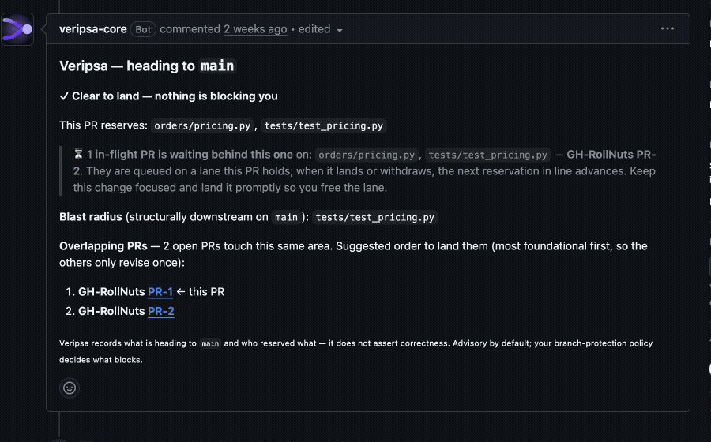

# AI PR Collision Lab

[](https://github.com/RollNuts/ai-pr-collision-lab/actions/workflows/fixtures.yml)

A small Python order-pricing fixture showing how two individually passing
changes can overlap in the same code. Run five local tests, inspect the scenario
manifest, or watch the historical GitHub check recording below.

> **Historical demo:** This repository originated as a fork of
> `GetVeripsa/ai-pr-collision-lab`. Its upstream is now private. The project-hosted
> Veripsa GitHub App has been suspended since **2026-08-18**; installing it will
> not currently produce checks or comments. The local fixture runs without an App.

## Run locally

Requires Python 3.9 or later.

```sh
git clone https://github.com/RollNuts/ai-pr-collision-lab.git
cd ai-pr-collision-lab
python3 -m venv .venv
. .venv/bin/activate
python3 -m pip install -e '.[test]'
python3 -m pytest -q
python3 scripts/check_docs.py
```

The CI badge covers this repository’s pricing tests and documentation checks.
It does not validate the absent scenario branches or the hosted App. Forking,
cloning, and testing this static project sends nothing to Veripsa; see
[data handling](./DATA_HANDLING.md).

## What the fixture demonstrates

Both historical scenarios change `orders/pricing.py` and
`tests/test_pricing.py`. Each was designed to pass its tests independently:

| Historical branch | Pretend author | Purpose |
| --- | --- | --- |
| `collide-a` | Agent A | Add a bulk discount inside calculate_total. |
| `collide-b` | Agent B | Add a large-cart discount in the same pricing area. |

The shared fixture base is `03f70bef401b65e0c275c8b34cf9fc6d83f85379`.
[`demo-manifest.json`](./demo-manifest.json) preserves the branch names, base,
expected paths, test commands, recorded-run metadata, and compatible historical
public-contract version **1.0.0**. [`AGENTS.md`](./AGENTS.md) records how agents
were expected to interpret the advisory states.

The `collide-a` and `collide-b` branch refs are not included in this repository.
The legacy [`scripts/verify_fixtures.py`](./scripts/verify_fixtures.py) therefore
cannot reproduce or verify both scenarios from a fresh clone. The available
local quickstart tests the pricing service on `main`; CI intentionally runs
those tests and manifest/document parity checks only.

For evaluating structural signals on your own repository, see
[Veripsa Core offline evaluation](https://github.com/RollNuts/veripsa#offline-evaluation).

## Historical recording



The public run was captured on **2026-07-16** at commit
`03f70bef401b65e0c275c8b34cf9fc6d83f85379`, compatible with historical public
contract **v1.0.0**. PR #1 held the earlier position while PR #2 was open; the
comment on PR #2 updated after the earlier PR landed.

A compact [MP4 version](./media/veripsa-two-prs-before-after.mp4) is also included.
The recording preserves the past GitHub workflow. It does not assert that either
change was correct or safe to merge, and it does not demonstrate a currently
available hosted service.

## Repository map

- [`orders/pricing.py`](./orders/pricing.py) — order totals.
- [`orders/catalog.py`](./orders/catalog.py) — tiny in-memory product catalog.
- [`tests/test_pricing.py`](./tests/test_pricing.py) — local pricing tests.
- [`scripts/check_docs.py`](./scripts/check_docs.py) — checks README and agent
  guidance against the manifest.

## License

The code and documentation are available under the [MIT License](./LICENSE).
